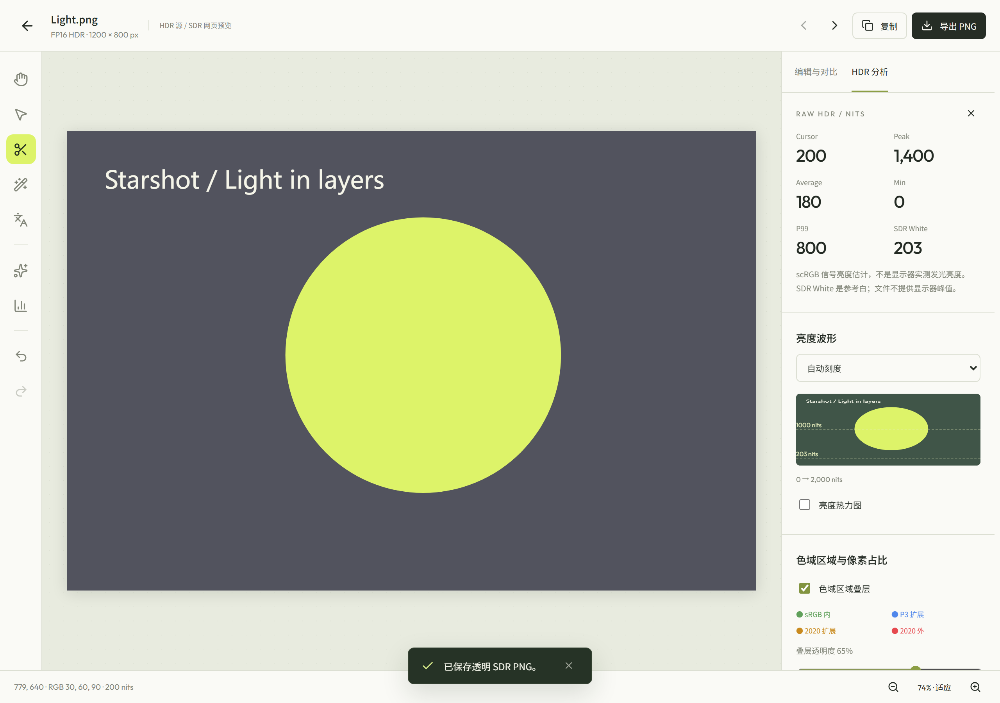
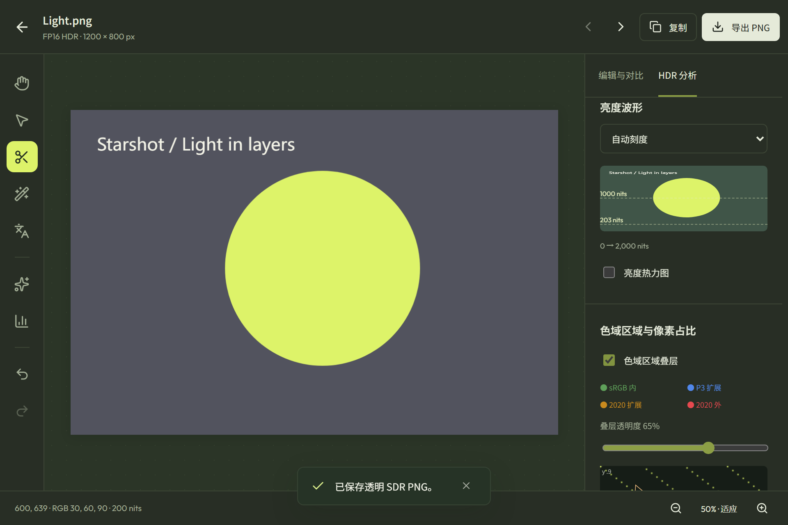

# Windows 图像工作区交付记录

2026-10-15。仅 Windows Starshot。保留工作区原有修改，不涉及 Android。

**这次续作没有运行任何 OCR、翻译或分割模型，也没有运行真实截图或 GPU 图像测试。**
用户正在使用显存，因此只执行 CPU 检查、模拟桥接交互、软件渲染 UI 和 Debug 构建。
代码已接入源码版；原生 HDR 显示及真实模型质量的最终验收仍待进行。

## 使用入口

- 双击仓库根目录 `Run-Starshot.cmd`，构建并运行 Debug 源码版。
- 图库点击图片直接进入内置工作区：缩放、平移、上一张/下一张，不再要求第三方软件。
- 右侧「双图对比」选择另一张图片，可分割或并排，同步缩放和平移。
- 区域截图工具栏「抠图」进入同一编辑器；「更多 → 原位翻译覆盖」进入覆盖编辑。
- 左侧多边形、套索、魔棒、智能抠图。多边形 `Ctrl+Z` 优先撤销最后一个顶点，
  `Ctrl+Y` / `Ctrl+Shift+Z` 重做，Enter 完成；已生成蒙版也有历史记录。
- 图库文件的顶点、历史和翻译层可恢复草稿。新截图替换编辑器前会确认并保存进度。
  未导出的临时截图仅在当前进程保留像素，关闭应用前应导出；草稿不冒充截图备份。
- 「模型管理库」统一放置 Tiny/Small OCR、Index Q5_K_M 和 U²-Net compact。
  下载、进度、取消、校验、删除及翻译后端切换均接入消息桥。
- 原位翻译允许编辑文字、调整文本框、切换明暗底色。只在明确复制/导出时合成。
- 网页工作区明确显示 **SDR 预览**；真实 HDR 使用内置原生查看器。

## 实现与实际修改

### 解码

- `Features/Codec/UhdrLinearDecoder.cs`：CPU 完整 gain-map 重建为 FP16，尺寸上限
  64 MP；按真实 stride 逐行复制，保存解码输出色域。没有创建 CanvasDevice。
- `UhdrImageDecoder.cs`：把解码结果转换到绝对 scRGB，参考白只缩放一次，
  `1.0 scRGB = 80 nits`；原色转换保留负值。原生资源使用作用域释放。
- `UhdrReferenceWhite.cs`：有界 EXIF 参考白读写；外部文件无此信息时使用 203 nits
  作为呈现参考，**不是**来源显示器的实测白点。
- `ImageLoader.cs`、`ImageInfo.cs`：JPEG/UHDR 识别和 HDR/载体信息。
- `ImageSaver.cs`：仅增加参考白元数据，没有修改 gain-map 像素、SDR base 数学或编码质量。

CPU 原生测试实际发现了两个问题并修复：

1. 固定版本 libultrahdr v2.0.2 在 `Probe` 后就锁定输出配置，而错误文本提到 Decode。
   现在先用短生命周期 probe 获取尺寸/元数据，再在另一解码 context 中先配置输出后解码。
2. 压缩 JPEG 基图与 gain-map 组装路径忽略 `encoder.SetExifData`。
   现在在**组装前**向基图添加 EXIF，随后由原库生成正确 MPF 索引；不在最终文件上插段破坏偏移。

### 编辑、比较和分析

- `Features/Workspace/WorkspaceDocument.cs`：独立 CPU 快照，释放捕获/解码的临时 GPU 对象；
  BGRA 显示与原始 FP16 分开。区域最多 4000 万像素，预览最长边 4096。
- `ImageMask.cs`：多边形偶奇填充、连通背景魔棒、预乘 alpha 合成，边界校验及取消。
  没有引入 GPU 到轻量截图路径。
- `GamutAnalysis.cs`：原始 scRGB → XYZ，嵌套 sRGB/P3/2020 区域及互斥占比、xy 密度图、
  1024px 色域区域叠层。大图约百万像素抽样并标注近似；黑色/无效像素不计入色域分母。
  FP16 色域边界使用相对 0.08% 数值容差，保留负通道。
- 亮度统计复用现有 `HdrLuminanceAnalysis`，原始像素读数、Max/Avg/Min/P99、波形刻度、
  热力图均位于按需打开的检查面板。关闭释放分析缓存；分析叠层不进入保存/复制。
- `WorkspaceTextOverlay.cs`：显式导出时 CPU/GDI 合成文字。
- `Features/WebUI/WebUiBridge.Workspace.cs`：串行会话所有权、取消、文件 ID 校验、
  蒙版事务提交、比较、分析、导出和草稿。草稿大小有上限，临时导出原子落盘。
- `RegionToolbarModel.cs`、`ScreenCaptureService*.cs`、`MainWindow.cs`：共享工具入口及
  已冻结像素的编辑器交接。WGC context、编码算法和已有捕获生命周期未修改。
- 前端 `ImageWorkspace.tsx/.css`、`imageEditing.ts`、`App.tsx`：内部查看器与历史，
  图像坐标映射、双图同步、草稿恢复，以及新截图进入时保护尚未保存的顶点。

逐像素误差只用于同尺寸、同 HDR/SDR 信号类型图像；HDR 比较原始线性 RGB，单位
nits/channel，SDR 则是线性相对 RGB。尺寸或信号类型不同会说明不可比较。

### 模型管理与原位翻译

- `Helpers/DlcModelStore.cs`、`WebUiBridge.Models.cs`、`ModelLibrary.tsx/.css`、
  `SettingsPanel.tsx`、`AppConfig.Setting.cs`：按需下载到当前应用数据目录，流式 SHA-256、
  进度/取消、校验和原子安装；切换/删除前等待使用者释放模型。
- `OfflineTranslation.cs`、`OcrTranslationClient.cs`、`OcrLab.tsx`：固定 llama.cpp
  b11429 CPU worker，首次翻译加载，四线程，GPU offload 为 0，60 秒空闲卸载。
  保留在线 API 方式；本地模型失败不会自动把文字发到外网。
- `BackgroundRemoval.cs`：ONNX Runtime 1.31.0 CPU，会话两线程，用后释放。
  模型没有下载 DLL、脚本或未知执行文件。
- `scripts/Restore-LocalInference.ps1`、`Starshot.csproj`：固定官方运行时包、SHA 校验、
  源码 Debug 输出与许可部署。模型不随应用启动加载。
- 模型精确来源、大小、SHA-256 和许可见
  [模型清单](../../../third_party/workspace-models/README.md)。
  Q5_K_M 1,454,787,072 bytes；u2netp 4,574,861 bytes。

## 本轮验证结果

| 检查 | 结果 | 证据 |
| --- | --- | --- |
| CPU 数学/蒙版/色域/EXIF/模拟下载、坏哈希、断网及取消 | 28 项通过；无模型推理 | [日志](core-tests-no-inference.log) |
| 真正 libultrahdr CPU 编解码 | 32 项通过，BT.709/P3、80/203/320 nits 参考白、16× 增益、HDR >1、stride、普通 JPEG、取消 | [日志](uhdr-cpu.log) |
| 轻量 GDI 合成回归 | 146 项通过；不捕获桌面、不访问剪贴板、不落盘截图 | [日志](cpu-capture-regression.log) |
| 前端单元测试 | 16/16 通过，含历史上限、坐标、草稿、替换保护与桥接取消 | `npm test` |
| 新工作区与模型页软件渲染 UI | 1280×900 浅色、960×640 深色，均 200% 缩放；无 JS 异常 | [日志](workspace-ui.log) |
| 编辑交互 | 双图分割/并排、逐点撤销重做、蒙版取消、魔棒/套索、草稿恢复、导出 payload、模型管理按钮通过；推理回复均模拟 | 同上 |
| 现有 OCR 小窗软件渲染回归 | 4 种窗口大小、选区格式/自动复制/翻译消息桥通过；无真实 OCR | [日志](ocr-popup-ui.log) |
| 现有翻译 API 模拟回归 | 排版、DPAPI、模型发现、格式片段校验通过；未调用大模型 | [日志](translation-api-mock.log) |
| 源码启动脚本 `-BuildOnly` | Debug x64，0 warnings / 0 errors，构建 42.92 秒；没有启动应用 | [日志](source-run-build.log) |

轻量回归日志中的一次 `Failed to destroy CPU capture window` 是已有测试刻意从错误线程
调用 DestroyWindow 的失败重试用例；随后确认创建线程可正确释放，并非测试残留窗口。

前端 Vite 仍有大于 500 kB 的 chunk 提示。它不影响类型检查或构建通过，也不能据此声称
真实首屏性能已经验收。源码输出已包含 ONNX Runtime 1.31.0 及运行时/模型许可资料。

## 尚待验证与限制

- **真实 OCR、离线翻译、智能分割质量与资源占用本轮暂停。** 之前阶段有有限模型烟雾测试，
  不能替代真实照片、复杂截图、日文和长文本验证，也不作为本轮新增实测结果。
- 原生 UHDR 显示/高光颜色、Win2D 上传与屏幕呈现、HDR 选区到编辑器、真实 DPI/多屏、
  4K/8K 延迟/显存和长时间运行，需之后允许 GPU 测试再验收。
- 本轮 UHDR CPU 灰阶重建误差约 0.21%，不足以证明所有广色域色相和有损文件都已正确。
- 编辑器复制/导出明确使用透明 **SDR PNG**，不将 HDR 数据伪装成带透明度的 HDR 文件。
  原始 HDR 文件保留，可在原生查看器打开；不在 HTML 中假装真实 HDR 输出。
- 原位覆盖使用可编辑明/暗文本底框，不是内容感知修复或自动背景重建。离线翻译跨样式
  片段上下文有限；短语歧义仍可能影响质量。
- 紧凑 U²-Net 的复杂边缘质量未验收；多边形/套索/魔棒是替代蒙版，没有虚构自动细节修复。
- 对普通 SDR/轻量截图禁用绝对 nits；跨显示器区域无法确认原始 HDR 资格时不提供 nits。
- 没有制作 Release、覆盖安装、推送或发布。

## UI 代表样本

以下为软件渲染、模拟分析回复的界面检查，不是真实 HDR 波形或模型结果。

